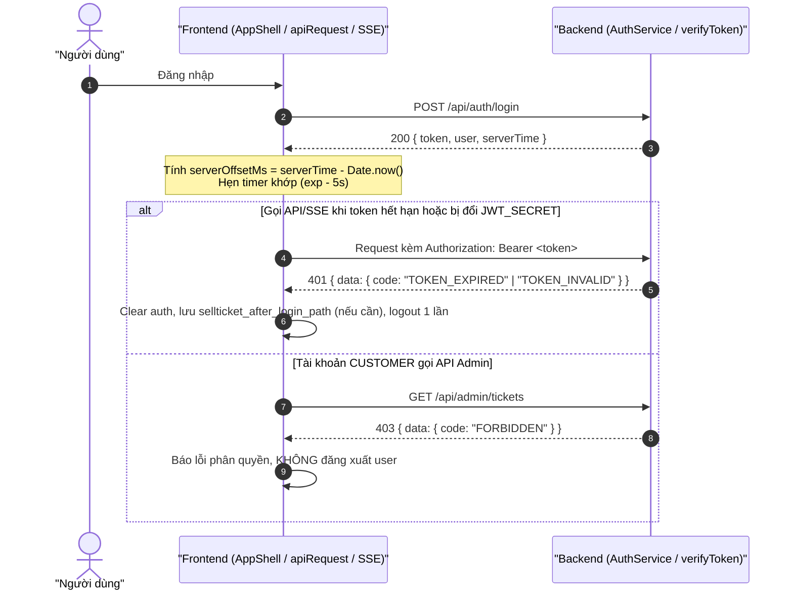

# Tự động đăng xuất khi Token hết hạn & Chuẩn hóa lỗi Auth 401/403

**Phạm vi:** Backend (`sell-ticket-be-demo/`) — Đồng bộ với Frontend nhánh `fix/auto-logout-expired-token`  
**Nhánh làm việc:** `fix/auto-logout-expired-token`  
**Cập nhật:** 2026-11-23  
**Self-check:** `node test/auth-middleware.check.js` và `node test/dto-envelope.check.js` (không cần DB / `.env`)

---

## 🎯 1. Tổng quan & Thay đổi so với luồng cũ

Trước đây, `verifyToken` trong [src/middlewares/auth.middleware.js](../../src/middlewares/auth.middleware.js) trả HTTP `403` với thông báo chung `"Token không hợp lệ hoặc đã hết hạn."` cho mọi lỗi JWT, đồng thời `POST /api/auth/login` không trả `serverTime` và `JWT_EXPIRES_IN` bị gán cứng `'1d'`. Điều này khiến Frontend phải đoán lỗi hết hạn qua chuỗi tiếng Việt, dễ nhầm với `403` phân quyền, và không bù được sai lệch đồng hồ client–server khi hẹn giờ tự đăng xuất.

| Hạng mục | Trước đây | Hiện tại |
| :--- | :--- | :--- |
| **Token hết hạn / sai chữ ký** | HTTP `403`, không có `data.code` | HTTP **`401`** kèm `data.code` (`TOKEN_EXPIRED` / `TOKEN_INVALID`) |
| **Thiếu token / sai prefix Bearer** | `authHeader.split(' ')[1]`, `401` không có `data.code` | Parse an toàn `startsWith('Bearer ')` + `.trim()`, trả **`401`** + `data.code = 'AUTH_REQUIRED'` |
| **Lỗi phân quyền (`requireAdmin`, `authorizeRoles`)** | HTTP `403`, `data: null` | Giữ nguyên HTTP **`403`**, bổ sung **`data: { code: 'FORBIDDEN' }`** |
| **Response `POST /api/auth/login`** | Chỉ trả `{ token, user }` | Trả thêm **`serverTime`** (ISO 8601) trong `data`, tương thích ngược 100% |
| **Thời hạn JWT (`JWT_EXPIRES_IN`)** | Gán cứng `'1d'` trong `constants.js` | `process.env.JWT_EXPIRES_IN \|\| '1d'` (dễ cấu hình khi QA test `20s`) |

> [!NOTE]
> Không có thay đổi Database schema và không cài thêm thư viện ngoài.

---

## 📜 2. Hợp đồng API & Mã lỗi chuẩn (`401` vs `403`)

Mọi phản hồi JSON đi qua [apiResponseMiddleware](../../src/middlewares/api-response.middleware.js) (`src/middlewares/api-response.middleware.js`) theo envelope chuẩn `{ success, statusCode, message, data }`.

### 2.1. Bảng mã lỗi xác thực & phân quyền

| Tình huống | Middleware | HTTP Status | `data.code` | Envelope trả về |
| :--- | :--- | :---: | :--- | :--- |
| Thiếu header, sai prefix không phải `Bearer `, hoặc token rỗng | `verifyToken` | `401` | `AUTH_REQUIRED` | `{ success: false, statusCode: 401, message: "Bạn chưa đăng nhập.", data: { code: "AUTH_REQUIRED" } }` |
| JWT hết hạn (`err.name === 'TokenExpiredError'`) | `verifyToken` | `401` | `TOKEN_EXPIRED` | `{ success: false, statusCode: 401, message: "Phiên đăng nhập đã hết hạn. Vui lòng đăng nhập lại.", data: { code: "TOKEN_EXPIRED" } }` |
| JWT sai chữ ký (`JWT_SECRET` khác) hoặc sai định dạng | `verifyToken` | `401` | `TOKEN_INVALID` | `{ success: false, statusCode: 401, message: "Phiên đăng nhập không hợp lệ. Vui lòng đăng nhập lại.", data: { code: "TOKEN_INVALID" } }` |
| Đã đăng nhập nhưng sai vai trò (`CUSTOMER` gọi API Admin hoặc ngược lại) | `authorizeRoles` / `requireAdmin` | `403` | `FORBIDDEN` | `{ success: false, statusCode: 403, message: "...", data: { code: "FORBIDDEN" } }` |

### 2.2. Response `POST /api/auth/login` (`LoginResponseDTO`)

`AuthService.login()` ([src/services/auth.service.js](../../src/services/auth.service.js)) trả kèm `serverTime: new Date().toISOString()` và `authController.login()` ([src/controllers/auth.controller.js](../../src/controllers/auth.controller.js)) truyền vào `new LoginResponseDTO(result.token, result.user, result.serverTime)`:

```json
{
  "success": true,
  "statusCode": 200,
  "message": "Đăng nhập thành công!",
  "data": {
    "token": "<jwt>",
    "user": {
      "id": "uuid",
      "email": "user@example.com",
      "fullName": "Nguyen Van A",
      "role": "CUSTOMER",
      "phone": "0901234567"
    },
    "serverTime": "2026-11-23T14:00:00.000Z"
  }
}
```

- **Tương thích ngược:** `LoginResponseDTO` ([src/dto/auth.dto.js](../../src/dto/auth.dto.js)) dùng default parameter `serverTime = new Date().toISOString()`, nên nơi gọi kiểu cũ 2 tham số `new LoginResponseDTO(token, user)` vẫn hoạt động bình thường.

---

## ⚙️ 3. Cấu hình môi trường (`JWT_EXPIRES_IN`)

Trong [src/config/constants.js](../../src/config/constants.js):

```js
JWT_EXPIRES_IN: process.env.JWT_EXPIRES_IN || '1d',
```

- Môi trường production / dev bình thường không cần thêm biến này vào `.env` (mặc định giữ nguyên `'1d'`).
- Khi cần QA test luồng FE tự động đăng xuất theo đồng hồ server, thêm tạm vào `sell-ticket-be-demo/.env` và restart server:

```env
JWT_EXPIRES_IN=20s
```

---

## 🔄 4. Sơ đồ phối hợp BE ↔ FE



---

## 📁 5. Danh sách file tác động

| File | Trách nhiệm |
| :--- | :--- |
| [src/config/constants.js](../../src/config/constants.js) | Cho phép override `JWT_EXPIRES_IN` qua `process.env.JWT_EXPIRES_IN \|\| '1d'` |
| [src/middlewares/auth.middleware.js](../../src/middlewares/auth.middleware.js) | Parse Bearer an toàn; `verifyToken` trả `401` + `AUTH_REQUIRED`/`TOKEN_EXPIRED`/`TOKEN_INVALID`; `authorizeRoles` & `requireAdmin` giữ `403` + `data.code = 'FORBIDDEN'` |
| [src/dto/auth.dto.js](../../src/dto/auth.dto.js) | Bổ sung `serverTime` (có default) vào `LoginResponseDTO.data` |
| [src/services/auth.service.js](../../src/services/auth.service.js) | Trả `serverTime: new Date().toISOString()` trong `AuthService.login()` |
| [src/controllers/auth.controller.js](../../src/controllers/auth.controller.js) | Truyền `result.serverTime` vào `new LoginResponseDTO(...)` |
| [test/dto-envelope.check.js](../../test/dto-envelope.check.js) | Bổ sung assert cho `LoginResponseDTO.data.serverTime` (cả 2 tham số & 3 tham số) |
| [test/auth-middleware.check.js](../../test/auth-middleware.check.js) | *(Tạo mới)* 9 test case độc lập không cần DB cho `verifyToken`, `requireAdmin`, `authorizeRoles` |
| [docs/api/authentication.md](../api/authentication.md) | Cập nhật tài liệu `POST /api/auth/login` và bảng mã lỗi `401`/`403` |
| [docs/auth/AUTO_LOGOUT_EXPIRED_TOKEN.md](./AUTO_LOGOUT_EXPIRED_TOKEN.md) | Tài liệu tổng hợp cho team BE |
| [docs/README.md](../README.md) | Cập nhật mục lục, hằng số và hướng dẫn lỗi JWT |

---

## 🧪 6. Kiểm tra tự động & Hướng dẫn QA cho team

### 6.1. Kiểm tra tự động (không cần DB / `.env`)

```powershell
cd sell-ticket-be-demo
Get-ChildItem -Recurse -Filter "*.js" -Path "src","app.js" | ForEach-Object { node --check $_.FullName }
node test/dto-envelope.check.js
node test/auth-middleware.check.js
node test/bank-dto.check.js
node test/payment-checkout.check.js
```

Kết quả đã xác nhận: toàn bộ syntax check pass 0 lỗi; `dto-envelope.check OK`, `auth-middleware.check OK`, `bank-dto.check OK`, `payment-checkout.check OK`.

### 6.2. Kịch bản kiểm tra nhanh với Frontend

1. Thêm `JWT_EXPIRES_IN=20s` vào `sell-ticket-be-demo/.env` và khởi động BE + FE.
2. Đăng nhập → chờ `~15s` (mốc `20s - 5s`) trên `/events` → FE tự đăng xuất tại chỗ với 1 toast thông báo.
3. Trong lúc FE đang mở `/events/:id`, đổi tạm `JWT_SECRET` rồi restart BE → bấm **Giữ ghế** → BE trả `401 TOKEN_INVALID` → FE tự đăng xuất, lưu `/events/:id`, chuyển `/login`.
4. Dùng tài khoản `CUSTOMER` gọi API `/api/admin/tickets` → BE trả `403 FORBIDDEN` → FE không bị đăng xuất nhầm.
