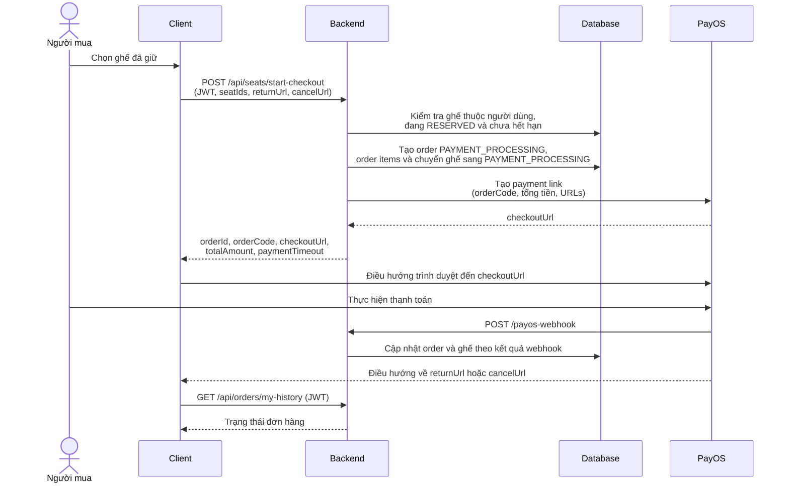

# Luồng thanh toán PayOS

Tài liệu mô tả luồng từ client đến backend và PayOS theo cách triển khai hiện tại.

## Thành phần

- **Client**: ứng dụng web của người mua; gửi yêu cầu checkout và điều hướng trình duyệt.
- **Backend**: xác thực người dùng, kiểm tra ghế, tính tiền, tạo đơn và gọi PayOS.
- **PayOS**: tạo trang thanh toán, xử lý giao dịch, gửi webhook về backend và điều hướng người mua về client.
- **Database**: lưu đơn hàng, chi tiết đơn và trạng thái ghế.

## Tổng quan



## Chi tiết các bước

### 1. Client yêu cầu tạo thanh toán

Người mua cần đăng nhập và giữ ghế thành công trước khi checkout. Client gọi:

```http
POST /api/seats/start-checkout
Authorization: Bearer <jwt>
Content-Type: application/json
```

```json
{
  "seatIds": ["<seat-uuid-1>", "<seat-uuid-2>"],
  "returnUrl": "https://client.example/payment/return",
  "cancelUrl": "https://client.example/payment/cancel"
}
```

- `seatIds` là bắt buộc và phải là mảng không rỗng.
- `returnUrl` và `cancelUrl` không bắt buộc. Nếu bỏ qua, backend dùng URL mặc định với `status=success` hoặc `status=cancel`.
- Backend luôn thêm `order_id=<order UUID>` vào query string của cả hai URL; nếu URL đã có `order_id`, giá trị sẽ được thay bằng ID của order vừa tạo. Ví dụ: `https://client.example/payment/return?status=success&order_id=<order-uuid>`.
- Endpoint yêu cầu JWT. Backend lấy người dùng từ token, không nhận `userId` hoặc tổng tiền do client gửi lên.

### 2. Backend xác thực ghế và tạo order

Backend khóa và kiểm tra các ghế được yêu cầu. Mỗi ghế phải có trạng thái `RESERVED`, được giữ bởi chính người dùng hiện tại và chưa hết thời gian giữ.

Nếu hợp lệ, backend:

1. Tính tổng tiền từ giá ghế lưu trong database.
2. Tạo order trạng thái `PAYMENT_PROCESSING` cùng mã `orderCode`.
3. Tạo các order item tương ứng.
4. Chuyển ghế sang `PAYMENT_PROCESSING`, gắn order hiện tại và gia hạn giữ ghế đến `paymentTimeout` (5 phút).
5. Gọi PayOS tạo payment link với `orderCode`, số tiền, mô tả và các URL quay về.

Nếu không thể tạo payment link, endpoint trả lỗi thay vì trả checkout URL thành công.

### 3. Backend trả checkout URL và client điều hướng

Phản hồi thành công có dạng:

```json
{
  "success": true,
  "message": "Khởi tạo thanh toán PayOS thành công!",
  "data": {
    "orderId": "<order-uuid>",
    "orderCode": 12345678,
    "checkoutUrl": "https://pay.payos.vn/web/...",
    "totalAmount": 1000000,
    "paymentTimeout": "2026-10-20T07:30:00.000Z"
  }
}
```

Client điều hướng **trình duyệt** đến `data.checkoutUrl`. Không gọi PayOS trực tiếp từ client và không xem việc quay về `returnUrl` là bằng chứng thanh toán thành công.

### 4. PayOS gửi webhook về backend

Webhook PayOS được xử lý tại:

```http
POST /payos-webhook
Content-Type: application/json
```

Backend đọc `orderCode` và kết quả giao dịch từ payload. Theo kết quả:

| Kết quả | Trạng thái order | Trạng thái ghế |
|---|---|---|
| Thành công (`code: "00"`) | `SUCCESS` | `SOLD` |
| Không thành công / bị hủy | `FAILED` | `AVAILABLE` |

Các cập nhật được thực hiện trong transaction. Webhook thành công lặp lại cho order đã `SUCCESS` không bán ghế lần nữa. Request webhook có `orderCode` không tìm thấy vẫn được ghi log và trả HTTP 200.

**Lưu ý về xác minh webhook:** backend thử xác minh payload bằng `payos.webhooks.verify`. Trong code hiện tại, nếu xác minh phát sinh lỗi, lỗi được ghi log nhưng payload vẫn tiếp tục được xử lý. Vì vậy không nên coi việc xác minh chữ ký là điều kiện bắt buộc đã được đảm bảo; cần rà soát hành vi này trước khi dùng production.

Ngoài `/payos-webhook`, backend còn đăng ký các đường dẫn `/api/payos-webhook` và `/api/payment/payos-webhook`. Có thể dùng `GET /api/payos-webhook` để kiểm tra endpoint health.

### 5. PayOS điều hướng client trở về và client kiểm tra trạng thái

Sau giao dịch, PayOS điều hướng người mua về `returnUrl` hoặc `cancelUrl`, có kèm `order_id`. Client có thể dùng giá trị này để gọi `GET /api/orders/{order_id}/invoice` bằng JWT và hiển thị đơn tương ứng. Query param `status` chỉ phục vụ giao diện, không phải bằng chứng thanh toán; trạng thái đáng tin cậy là `orderStatus` backend trả về sau khi webhook cập nhật order.

Lịch sử đơn hàng hiện được cung cấp tại:

```http
GET /api/orders/my-history
Authorization: Bearer <jwt>
```

Phản hồi chứa `orderStatus` để client hiển thị kết quả đã được backend ghi nhận. Nếu webhook chưa đến hoặc chưa xử lý xong, client có thể tiếp tục tải lại lịch sử đơn.

## Hết hạn thanh toán

Thời hạn thanh toán là 5 phút. Job nền quét ghế hết hạn mỗi 60 giây và đưa ghế có `reserved_until` quá hạn về `AVAILABLE`. Job hiện chỉ cập nhật ghế, không tự chuyển order tương ứng khỏi `PAYMENT_PROCESSING`; do đó trạng thái order không nên được suy ra chỉ từ trạng thái ghế hoặc thời gian quay về client.

## Cấu hình PayOS

Backend cần các biến môi trường sau để khởi tạo PayOS:

```env
PAYOS_CLIENT_ID=...
PAYOS_API_KEY=...
PAYOS_CHECKSUM_KEY=...
```

Nếu thiếu cấu hình, backend cảnh báo và checkout không thể tạo payment link.
