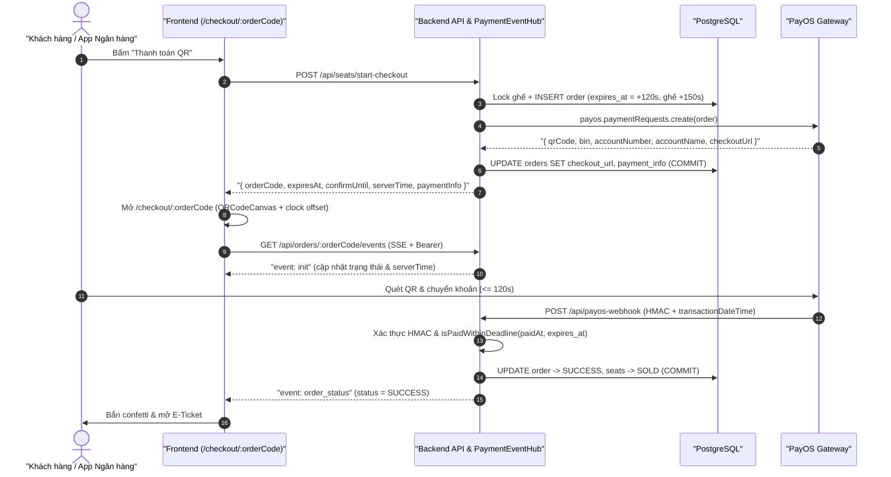

# In-Site PayOS QR Checkout (Thanh toán VietQR trực tiếp trên web)

**Phạm vi:** Backend (`sell-ticket-be-demo`) — Đồng bộ với Frontend `/checkout/:orderCode`  
**Cập nhật:** 2026-11-22  
**Self-check:** `node test/payment-checkout.check.js` (không cần DB / `.env`)

---

## 🎯 1. Tổng quan & Thay đổi so với luồng cũ

Trước đây, sau khi gọi `POST /api/seats/start-checkout`, Frontend chuyển hướng hẳn sang trang ngoài `checkoutUrl` của PayOS rồi quay về qua query string (`?cancel=true&status=...`). Với bản nâng cấp này, **toàn bộ quá trình tạo QR, hiển thị thông tin chuyển khoản, nhận kết quả và xử lý quá hạn diễn ra ngay tại website của mình (`/checkout/:orderCode`)**.

| Hạng mục | Luồng cũ (Redirect PayOS) | Luồng mới (In-Site QR Checkout) |
| :--- | :--- | :--- |
| **Điều hướng FE** | `window.location.href = checkoutUrl` | Ở lại SPA tại `/checkout/:orderCode`, render QR bằng `paymentInfo.qrCode` |
| **Thời gian thanh toán** | Không đồng nhất, có `PAYMENT_GRACE_SECONDS` | Cứng **`120s`** quét QR + **`30s`** cửa sổ chờ webhook xác nhận (`CONFIRMING`) |
| **Nhận kết quả thanh toán** | Polling status / redirect returnUrl | **Webhook HMAC + SSE realtime** (`/events`) + DB polling dự phòng + `?sync=1` có throttle |
| **Chống spam PayOS (429)** | Có thể gọi lặp `payos.paymentRequests.get` | Cooldown **`10s`/đơn** + `inFlight` deduplication (`syncOrderWithPayOSThrottled`) |
| **Chuyển tiền muộn (`> 120s`)** | Có lúc kích hoạt lại ghế nếu còn trống | **Cấm tuyệt đối cấp vé quá 120s** (`paidAt <= expires_at`), tự động đưa về `REFUND_PENDING` |
| **Hủy đơn khi đang xác nhận** | Cho hủy bất cứ lúc nào khi `PAYMENT_PROCESSING` | Pha `CONFIRMING` (120..150s) **khóa hủy `409 Conflict`** để chờ webhook giao dịch giờ chót |

---

## ⏱️ 2. Quy tắc thời gian & Nghiệp vụ cốt lõi (`120s + 30s`)

Tất cả hằng số được định nghĩa tập trung trong [src/config/constants.js](../../src/config/constants.js):

| Hằng số | Giá trị | Ý nghĩa |
| :--- | :--- | :--- |
| `SEAT_HOLD_DURATION_SECONDS` | `30` (giây) | Thời gian giữ ghế tạm thời trước khi bấm thanh toán |
| `PAYMENT_TIMEOUT_SECONDS` | `120` (giây) | Hạn thanh toán hợp lệ (`orders.expires_at` & PayOS `expiredAt`) |
| `PAYMENT_CONFIRM_WINDOW_SECONDS` | `30` (giây) | Cửa sổ chờ webhook ngân hàng sau giây 120 (`confirmUntil = expires_at + 30s`) |
| `PAYOS_SYNC_COOLDOWN_MS` | `10000` (10s) | Khoảng nghỉ tối thiểu giữa 2 lần gọi `payos.paymentRequests.get` cho cùng 1 đơn |
| `SEAT_RELEASE_JOB_INTERVAL_MS` | `15000` (15s) | Chu kỳ background job đối soát đơn quá `confirmUntil` & nhả ghế |
| `SSE_HEARTBEAT_INTERVAL_MS` | `15000` (15s) | Nhịp gửi `: heartbeat` giữ kết nối SSE |
| `SSE_ORDER_MAX_DURATION_MS` | `180000` (180s) | Thời lượng sống tối đa của 1 kết nối SSE (`120s + 30s + 30s buffer`) |

> [!NOTE]
> `PAYMENT_GRACE_SECONDS` đã được **gỡ bỏ hoàn toàn**, thay bằng mô hình 2 mốc tách biệt: **hạn chuyển tiền (`120s`)** và **hạn giữ ghế chờ đối soát (`150s`)**.

### 2.1. Hai mốc deadline & 3 pha (`phase`) trong `computeOrderTiming`

Khi gọi `startCheckoutSeats()`:
- `expiresAt = now + 120s` → lưu vào `orders.expires_at` và truyền làm `expiredAt` cho PayOS.
- `confirmUntil = expiresAt + 30s` (tức `now + 150s`) → lưu làm `seats.reserved_until` để bảo vệ ghế thêm 30s nếu khách bấm chuyển tiền ở giây 119 nhưng webhook PayOS báo về ở giây 124.

Hàm `computeOrderTiming()` trong [src/utils/payos-time.js](../../src/utils/payos-time.js) tính 3 pha cho FE và Backend:
1. **`WAITING`** (`status === 'PAYMENT_PROCESSING'` và `now < expires_at`): khách đang quét QR, được phép bấm **Hủy đơn**.
2. **`CONFIRMING`** (`status === 'PAYMENT_PROCESSING'` và `expires_at <= now`): đã hết 120s quét QR, đang trong cửa sổ chờ phản hồi cuối cùng từ ngân hàng. Lúc này:
   - API `POST /api/orders/:orderCode/cancel` **trả HTTP `409 Conflict`**.
   - `syncOrderWithPayOSThrottled()` **từ chối đánh `EXPIRED`** kể cả khi PayOS đã báo link `EXPIRED`, cho đến khi `now >= confirmUntil` (`150s`).
3. **`FINAL`** (`status !== 'PAYMENT_PROCESSING'`): đơn đã chốt (`SUCCESS`, `CANCELLED`, `EXPIRED`, `FAILED`, `REFUND_PENDING`, `REFUNDED`).

### 2.2. Quy tắc kiểm tra giờ giao dịch nghiêm ngặt (`paidAt <= expires_at`)

Trong [src/utils/payos-time.js](../../src/utils/payos-time.js):
- `parsePayOSTransactionTime(raw)`: PayOS thường gửi chuỗi `"YYYY-MM-DD HH:mm:ss"` theo giờ Việt Nam nhưng **không kèm offset**. Nếu gặp pattern này, hàm tự chuẩn hóa thành `+07:00` (`YYYY-MM-DDTHH:mm:ss+07:00`) trước khi `new Date(...)` để không bị sai lệch 7 tiếng trên server chạy múi giờ UTC.
- `extractLatestPaidAt(transactions)`: lấy mốc `transactionDateTime` muộn nhất hợp lệ trong mảng `transactions` từ `payos.paymentRequests.get()`.
- `isPaidWithinDeadline(paidAt, expiresAt)`: so sánh nghiêm ngặt `paidAt.getTime() <= expDate.getTime()`. **Quá hạn dù chỉ `1ms` cũng trả về `false`.**

Trong `handlePaymentWebhook()` ([src/services/ticket.service.js](../../src/services/ticket.service.js)):
- Nếu `isPaidOnTime === true` **và** đủ ghế đang ở trạng thái `PAYMENT_PROCESSING` gắn đúng `current_order_code` → `SUCCESS` + ghế chuyển `SOLD` + phát SSE.
- Nếu `isPaidOnTime === false` (thanh toán sau `expires_at`) **kể cả khi ghế vẫn đang giữ hoặc còn trống** → **TUYỆT ĐỐI KHÔNG CẤP VÉ**:
  1. Chuyển `PAYMENT_PROCESSING -> EXPIRED` và nhả ghế về `AVAILABLE`.
  2. Chuyển ngay `EXPIRED -> REFUND_PENDING` (Chờ hoàn tiền thủ công VietQR).
  3. Commit transaction rồi phát SSE `REFUND_PENDING` về FE.

---

## 🔄 3. Sơ đồ tuần tự End-to-End



---

## 🗄️ 4. Thay đổi Database & Migration

- **Migration file:** [docs/migrations/add_order_payment_info.sql](../migrations/add_order_payment_info.sql)
- **Seed đồng bộ:** [src/seeds/supabase_migration_web_ban_ve_sk.sql](../../src/seeds/supabase_migration_web_ban_ve_sk.sql)
- **Auto-verify khi khởi động:** [app.js](../../app.js) gọi `ticketRepository.ensureOrdersSchema()` kiểm tra cả `checkout_url` (`text`) và `payment_info` (`jsonb`), tự bổ sung bằng `ADD COLUMN IF NOT EXISTS` nếu DB thiếu.

```sql
ALTER TABLE public.orders
  ADD COLUMN IF NOT EXISTS payment_info jsonb;
```

### Vì sao lưu cả `payment_info` và `checkout_url` trong bảng `orders`?

1. **Tại sao bắt buộc lưu `payment_info` (JSONB)?**
   - Cấu trúc lưu: `{ paymentLinkId, bin, accountNumber, accountName, amount, description, qrCode, currency }`.
   - SDK PayOS chỉ trả `qrCode`, `bin`, `accountName` **một lần duy nhất** lúc gọi `paymentRequests.create()`, **không trả lại** khi gọi `paymentRequests.get()`. Nếu không lưu vào DB thì khi user bấm F5, mở lại từ banner/lịch sử đơn, hoặc đổi thiết bị sẽ không có `qrCode` để vẽ lại QR.
   - **Bảo mật & sạch dữ liệu đầu ra:** Khi truy vấn ở Repository (`getOrderWithItemsByCode`) và map trong DTO (`OrderPaymentResponseDTO`), `payment_info` tự động bị mask thành `NULL` ngay khi đơn rời `PAYMENT_PROCESSING`:
     ```sql
     CASE WHEN o.status = 'PAYMENT_PROCESSING' THEN o.payment_info ELSE NULL END AS payment_info
     ```
2. **Tại sao vẫn giữ `checkout_url` (nullable)?**
   - Frontend luồng mới không còn dùng URL này để redirect, nhưng vẫn giữ ghi vào DB để tương thích ngược dữ liệu cũ, phục vụ đối soát/debug khi cần kiểm tra link PayOS gốc trên dashboard và không phá vỡ API cũ (`OrderStatusResponseDTO`, `OrderHistoryItemDTO`).

---

## 🔌 5. Hợp đồng API chi tiết

> [!NOTE]
> Mọi JSON response dưới `/api/*` đều đi qua `apiResponseMiddleware` ([src/middlewares/api-response.middleware.js](../../src/middlewares/api-response.middleware.js)) và có envelope chuẩn:
> `{ "success": boolean, "statusCode": number, "message": string, "data": ... }`.  
> Riêng endpoint SSE (`/events`) trả `text/event-stream` thô, không đi qua wrapper JSON.

### 5.1. `POST /api/seats/start-checkout` (JWT Required)
Khởi tạo đơn hàng `PAYMENT_PROCESSING`, gia hạn ghế đến `confirmUntil` (`+150s`), tạo giao dịch PayOS và trả payload khởi tạo cho trang `/checkout/:orderCode`.

- **Response `data` (`CheckoutResponseDTO`):**
  ```json
  {
    "orderCode": 100000123,
    "totalAmount": 500000,
    "expiresAt": "2026-11-22T09:12:00.000Z",
    "confirmUntil": "2026-11-22T09:12:30.000Z",
    "paymentTimeout": "2026-11-22T09:12:00.000Z",
    "expiredAt": 1795338720,
    "serverTime": "2026-11-22T09:10:00.000Z",
    "paymentInfo": {
      "paymentLinkId": "abc123",
      "bin": "970436",
      "accountNumber": "1234567890",
      "accountName": "NGUYEN VAN A",
      "amount": 500000,
      "description": "VE SU KIEN 100000123",
      "qrCode": "000201010212...",
      "currency": "VND"
    }
  }
  ```

### 5.2. `GET /api/orders/:orderCode/payment[?sync=1]` (JWT Required — Owner Only)
Lấy đầy đủ thông tin thanh toán QR, tiến độ `phase` và danh sách vé của đơn hàng.

- **Bảo mật:** Kiểm tra `order.user_id === req.user.id`. Không tồn tại hoặc khác chủ sở hữu → HTTP `404`.
- **Tham số `sync`:**
  - Mặc định (`không có sync` hoặc `sync=false`): **chỉ đọc PostgreSQL**, không chạm PayOS.
  - Khi `?sync=1` hoặc `?sync=true` (và đơn đang `PAYMENT_PROCESSING`): chạy `syncOrderWithPayOSThrottled(order)` rồi trả dữ liệu mới nhất.
- **Response `data` (`OrderPaymentResponseDTO`):**
  ```json
  {
    "orderCode": 100000123,
    "status": "PAYMENT_PROCESSING",
    "phase": "WAITING",
    "totalAmount": 500000,
    "expiresAt": "2026-11-22T09:12:00.000Z",
    "confirmUntil": "2026-11-22T09:12:30.000Z",
    "serverTime": "2026-11-22T09:10:15.000Z",
    "createdAt": "2026-11-22T09:10:00.000Z",
    "paymentInfo": {
      "paymentLinkId": "abc123",
      "bin": "970436",
      "accountNumber": "1234567890",
      "accountName": "NGUYEN VAN A",
      "amount": 500000,
      "description": "VE SU KIEN 100000123",
      "qrCode": "000201010212...",
      "currency": "VND"
    },
    "eventId": "uuid-event",
    "eventTitle": "Concert ABC",
    "eventType": "SEAT_BASED",
    "eventStartTime": "2026-12-01T12:00:00.000Z",
    "location": "Nhà thi đấu XYZ",
    "items": [
      { "seatId": "uuid-seat", "seatNumber": "A1", "zoneName": "VIP", "price": 500000 }
    ]
  }
  ```

### 5.3. `GET /api/orders/:orderCode/events` (JWT Required — SSE Stream)
Stream Server-Sent Events đẩy trạng thái đơn ngay khi Webhook, API hủy đơn hoặc Cron Job làm thay đổi trạng thái đơn.

- **Bảo mật:** Xác thực qua header `Authorization: Bearer <token>` (tuyệt đối không dùng token trên URL) và kiểm tra ownership trước khi mở `text/event-stream` (`401`/`404` trả JSON lỗi).
- **Headers:** `Content-Type: text/event-stream; charset=utf-8`, `Cache-Control: no-cache, no-transform`, `Connection: keep-alive`, `X-Accel-Buffering: no`.
- **Quản lý kết nối (`PaymentEventHub` trong [src/utils/payment-events.js](../../src/utils/payment-events.js)):**
  - Tối đa **`5` kết nối/đơn hàng** (`MAX_CONNECTIONS_PER_ORDER = 5`): vượt quá 5 tab sẽ tự đóng kết nối cũ nhất.
  - Gửi `event: init` ngay khi kết nối. Nếu đơn đã terminal (khác `PAYMENT_PROCESSING`) → đóng stream ngay sau frame `init`.
  - Gửi `: heartbeat\n\n` mỗi `15s`; tự đóng sau tối đa `180s` (`SSE_ORDER_MAX_DURATION_MS`).
  - Khi nhận trạng thái terminal (`SUCCESS`, `CANCELLED`, `EXPIRED`, `REFUND_PENDING`, `FAILED`, `REFUNDED`) qua `event: order_status` → tự động đóng stream.

- **Mẫu SSE frames:**
  ```text
  event: init
  data: {"type":"INIT","orderCode":100000123,"status":"PAYMENT_PROCESSING","phase":"WAITING","serverTime":"2026-11-22T09:10:01.000Z","order":{...}}

  : heartbeat

  event: order_status
  data: {"type":"STATUS_CHANGED","orderCode":100000123,"status":"SUCCESS","phase":"FINAL","serverTime":"2026-11-22T09:11:12.000Z","order":{...}}
  ```

### 5.4. Các endpoint liên quan đã nâng cấp

| Endpoint | Thay đổi chính |
| :--- | :--- |
| `POST /api/orders/:orderCode/cancel` | Kiểm tra khóa row; trả **`409 Conflict`** nếu đơn đã rời `PAYMENT_PROCESSING` hoặc đang ở pha `CONFIRMING` (`now >= expires_at`). Khi hủy thành công: nhả ghế, đóng link PayOS, và `emitOrderStatusSnapshot` qua SSE. |
| `GET /api/orders/:orderCode/status` | Tái sử dụng `syncOrderWithPayOSThrottled` (tôn trọng `confirmUntil`), trả thêm `phase`, `confirmUntil`, `serverTime`, `eventStartTime` (`OrderStatusResponseDTO`). |
| `GET /api/seats/my-active-session` | Giữ phiên `PAYMENT_PROCESSING` tồn tại đến hết `confirmUntil` (150s), trả thêm `expiresAt`, `confirmUntil`, `serverTime`, `phase` để Banner/Detail đồng bộ đa thiết bị. |
| `POST /api/payos-webhook` | Đọc `verifiedData.transactionDateTime` truyền vào `handlePaymentWebhook()`, chỉ phát SSE **sau khi** `COMMIT` transaction thành công. |

---

## 🛡️ 6. Chống 429, Background Job & Kiến trúc triển khai

1. **Anti-429 PayOS Sync (`syncOrderWithPayOSThrottled`):**
   - `payosSyncInFlight` (Map theo `orderCode`): nếu có nhiều request `?sync=1` tới đồng thời cho cùng 1 đơn, chỉ gọi PayOS **1 lần** và share Promise.
   - `payosSyncLastAt` (Map cooldown `10s`): bỏ qua request sync lặp lại trong vòng 10s (trừ cron đối soát cuối truyền `{ force: true }`). Tự dọn entry quá 5 phút khi map vượt 200 phần tử.
   - Khi PayOS trả lỗi mạng/429: ghi log cảnh báo và trả về `null` để API fallback về trạng thái mới nhất trong DB thay vì quăng 500.
2. **Background Job (`src/jobs/seat-release.job.js`, chu kỳ 15s):**
   - Bước 1: `ticketService.reconcileExpiredProcessingOrders()` quét các đơn `PAYMENT_PROCESSING` đã quá `confirmUntil` (`expires_at + 30s`), ép đồng bộ PayOS lần cuối (`force: true`) để không sót giao dịch giờ chót trước khi nhả ghế.
   - Bước 2: `ticketRepository.releaseExpiredSeats(30)` giải phóng ghế quá hạn, cập nhật đơn quá `confirmUntil` sang `EXPIRED`, hủy link PayOS và phát SSE `EXPIRED` cho tất cả tab đang mở.
3. **Lưu ý scale nhiều instance:** `PaymentEventHub` lưu subscribers trong RAM (in-memory) — hoạt động chuẩn với kiến trúc 1 instance Node.js hiện tại; nếu mở rộng chạy nhiều instance sau này, cần thay tầng Pub/Sub bằng Redis (trong khi chờ nâng cấp, FE đã có cơ chế fallback DB polling 3s/12s nên vẫn tự cập nhật trạng thái bình thường).

---

## 🧪 7. Ma trận Edge Cases đã xử lý

| Kịch bản | Xử lý của Backend | Kết quả mong đợi |
| :--- | :--- | :--- |
| Chuyển tiền ở **119s**, webhook về ở **124s** | Ghế được khóa đến 150s (`confirmUntil`); `paidAt <= expires_at` | `SUCCESS` + ghế `SOLD` + SSE đẩy về FE |
| Chuyển tiền ở **120.001s / 121s** (dù ghế vẫn trống) | `isPaidWithinDeadline()` trả `false` | `PAYMENT_PROCESSING -> EXPIRED` (nhả ghế) `-> REFUND_PENDING` + SSE |
| Khách bấm **Hủy** lúc **125s** (pha `CONFIRMING`) | `timing.isPastExpiresAt === true` trong `cancelOrder()` | HTTP **`409`**, giữ đơn tiếp tục chờ kết quả ngân hàng |
| F5 trang, mở từ Banner hoặc thiết bị khác | `payment_info` lưu bền trong DB `orders` | Vẫn render đúng mã QR & đếm ngược theo `serverTime` |
| Mở `>= 6` tab SSE cùng theo dõi 1 đơn | `MAX_CONNECTIONS_PER_ORDER = 5` | Tự đóng tab kết nối cũ nhất, không rò rỉ socket |
| PayOS rate limit (`429`) hoặc mất mạng tạm thời | Throttled sync nuốt lỗi, fallback DB + Webhook vẫn chạy | Không trả 500, FE tiếp tục đếm ngược ổn định |

---

## 📦 8. Danh sách file Backend & Kiểm thử

### Các file tạo mới / chỉnh sửa (13 files)
- `docs/migrations/add_order_payment_info.sql` *(mới)* — migration thêm `orders.payment_info jsonb`.
- `src/utils/payos-time.js` *(mới)* — chuẩn hóa múi giờ `+07:00`, `isPaidWithinDeadline`, `computeOrderTiming`.
- `src/utils/payment-events.js` *(mới)* — `PaymentEventHub` cho SSE theo `orderCode`.
- `test/payment-checkout.check.js` *(mới)* — bộ kiểm thử 119s/120s/120.001s/121s, DTO, SSE hub.
- `app.js` — gọi `ensureOrdersSchema()` nhắc chạy đủ cả 2 migration.
- `src/config/constants.js` — `120s`, `30s`, `10s` sync cooldown, `180s` max SSE.
- `src/seeds/supabase_migration_web_ban_ve_sk.sql` — đồng bộ schema `orders.payment_info jsonb`.
- `src/dto/order.dto.js` — `CheckoutResponseDTO`, `OrderPaymentResponseDTO`, cập nhật `OrderStatusResponseDTO` & `OrderHistoryItemDTO`.
- `src/repositories/ticket.repository.js` — schema bootstrap, lưu/mask `payment_info`, query các đơn quá `confirmUntil`.
- `src/services/ticket.service.js` — webhook strict 120s, `syncOrderWithPayOSThrottled`, `cancelOrder` khóa 409, `emitOrderStatusSnapshot`, `reconcileExpiredProcessingOrders`.
- `src/controllers/ticket.controller.js` — `getOrderPayment`, `streamOrderEvents` (SSE), truyền `transactionDateTime` từ webhook.
- `src/routes/order.routes.js` — đăng ký `GET /:orderCode/payment` và `GET /:orderCode/events`.
- `src/jobs/seat-release.job.js` — đối soát cuối trước khi nhả ghế và emit SSE `EXPIRED`.

### Lệnh áp dụng & tự kiểm tra cho thành viên mới
```bash
# 1. Áp dụng migration (nếu DB cũ chưa có cột payment_info)
psql "$DATABASE_URL" -f docs/migrations/add_order_payment_info.sql

# 2. Kiểm tra syntax & chạy toàn bộ unit self-check (KHÔNG cần DB hay file .env)
node test/dto-envelope.check.js
node test/bank-dto.check.js
node test/payment-checkout.check.js
```

---

## 🔗 Tài liệu liên quan
- [PAYMENT_FLOW.md](./PAYMENT_FLOW.md) — Vòng đời đơn hàng & trạng thái tổng quan
- [MANUAL_REFUND_VIETQR.md](../refund/MANUAL_REFUND_VIETQR.md) — Luồng Admin hoàn tiền thủ công cho đơn `REFUND_PENDING`
- [Database Migrations](../migrations/README.md) — Danh sách và lịch sử các migration DB
