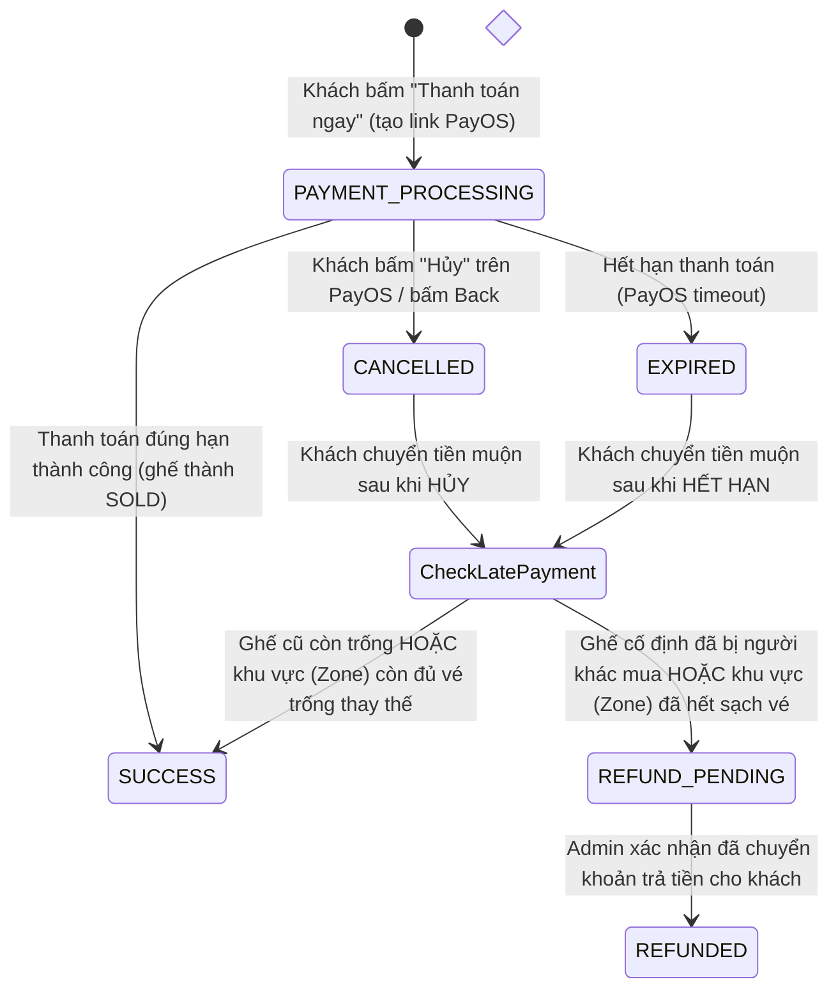

# Hướng dẫn Luồng Thanh toán PayOS & Giữ chỗ (Payment Flow Docs)

Tài liệu tóm tắt kiến trúc và luồng thanh toán tích hợp cổng **PayOS** trong hệ thống bán vé.

---

## 1. Vòng đời đơn hàng (`order_status`)

| Trạng thái | Ý nghĩa | Trạng thái ghế |
| :--- | :--- | :--- |
| `PAYMENT_PROCESSING` | Đang ở cổng PayOS, chờ quét mã QR | `PAYMENT_PROCESSING` (gắn `current_order_code`) |
| `SUCCESS` | Đã thanh toán thành công, vé hợp lệ | `SOLD` (Đã bán) |
| `CANCELLED` | Khách hủy hoặc bấm quay lại | `AVAILABLE` (Mở lại cho người khác) |
| `EXPIRED` | Quá thời gian chờ thanh toán | `AVAILABLE` |
| `REFUND_PENDING` | Chuyển tiền sau khi đơn đã hủy, ghế đã bị người khác lấy | Ghế cũ đã thuộc về người mới |
| `REFUNDED` | Admin đã hoàn lại tiền cho khách | - |

---

## 2. Các luồng xử lý chi tiết

### A. Khách thanh toán bình thường (Happy Path)
1. User chọn ghế/khu vực -> Bấm "Giữ chỗ" (Khóa 30 giây bằng `SKIP LOCKED`).
2. Bấm "Thanh toán ngay":
   - Backend gọi PayOS SDK tạo link thanh toán, tạo đơn hàng với `order_code` (9 chữ số).
   - Ghế chuyển sang trạng thái `PAYMENT_PROCESSING` (gắn kèm `current_order_code`).
3. Khách quét mã QR trên App ngân hàng -> PayOS gửi Webhook về Backend.
4. Backend chuyển đơn sang `SUCCESS`, ghế chuyển sang `SOLD` và xuất vé điện tử (E-Ticket).

### B. Khách bấm HỦY trên màn hình PayOS hoặc bấm nút Back
1. PayOS chuyển hướng về web kèm `?cancel=true&status=CANCELLED&orderCode=...`.
2. Frontend gọi API `POST /api/seats/release` (hoặc `POST /api/orders/:orderCode/cancel`).
3. Backend:
   - Đổi trạng thái đơn thành `CANCELLED`.
   - Giải phóng ghế về `AVAILABLE` (`reserved_by = NULL`, `current_order_code = NULL`).
   - Gọi PayOS SDK hủy link thanh toán tương ứng.
4. Giao diện Frontend hiển thị 1 thông báo ngắn gọn và mở lại ghế cho user.

### C. Khách chuyển tiền muộn (Edge Case: Quét mã trước, bấm Hủy sau rồi mới bấm Chuyển tiền)
Trường hợp khách đã quét QR trên điện thoại, sau đó trên web lỡ bấm Hủy (hoặc hết hạn), rồi một lúc sau mới bấm Chuyển tiền trên app ngân hàng:
- **Nếu là sự kiện ZONE_BASED (vé khu vực đứng)**:
  - Nếu vị trí cũ đã bị người khác chọn, Backend tự động dùng `FOR UPDATE SKIP LOCKED` tìm ghế trống khác trong cùng Zone bù vào đơn -> Chuyển thành `SUCCESS` và cấp vé bình thường!
  - Chỉ khi cả Zone đó đã hết sạch 100% vé thì mới chuyển sang `REFUND_PENDING`.
- **Nếu là sự kiện SEAT_BASED (ghế cố định)**:
  - Nếu ghế cũ vẫn trống -> Tự động kích hoạt lại và cấp vé `SUCCESS`.
  - Nếu ghế đã bị người khác chọn/mua -> Đơn chuyển sang `REFUND_PENDING` (Chờ hoàn tiền). Tiền của khách được bảo vệ an toàn.
- **Admin xử lý hoàn tiền**:
  - Admin vào trang quản trị -> Tab **"Quản lý hoàn tiền"** (`/admin`).
  - Xem danh sách các đơn `REFUND_PENDING`, kiểm tra thông tin tài khoản và chuyển khoản lại tiền cho khách.
  - Bấm **"Xác nhận đã hoàn tiền"** -> Hệ thống chuyển đơn sang `REFUNDED`.

---

## 3. Danh sách API chính

| Method | Endpoint | Mô tả |
| :--- | :--- | :--- |
| `POST` | `/api/seats/reserve` | Giữ ghế tạm thời (30s) bằng cơ chế `SKIP LOCKED` |
| `POST` | `/api/seats/reserve-zone` | Giữ chỗ vé khu vực (ZONE_BASED) |
| `POST` | `/api/seats/start-checkout` | Tạo đơn hàng và lấy link thanh toán PayOS |
| `POST` | `/api/payos-webhook` | Webhook nhận kết quả tự động từ PayOS kèm xác thực HMAC SHA256 |
| `POST` | `/api/orders/:orderCode/cancel` | Hủy đơn và hủy link PayOS |
| `POST` | `/api/seats/release` | Giải phóng ghế đang giữ về `AVAILABLE` |
| `GET` | `/api/orders/:orderCode/status` | Đồng bộ trạng thái đơn hàng giữa web và PayOS |
| `GET` | `/api/admin/refunds` | Lấy danh sách các đơn cần hoàn tiền (`REFUND_PENDING`) |
| `POST` | `/api/admin/orders/:orderCode/confirm-refund` | Admin xác nhận đã hoàn tiền (`REFUNDED`) |
