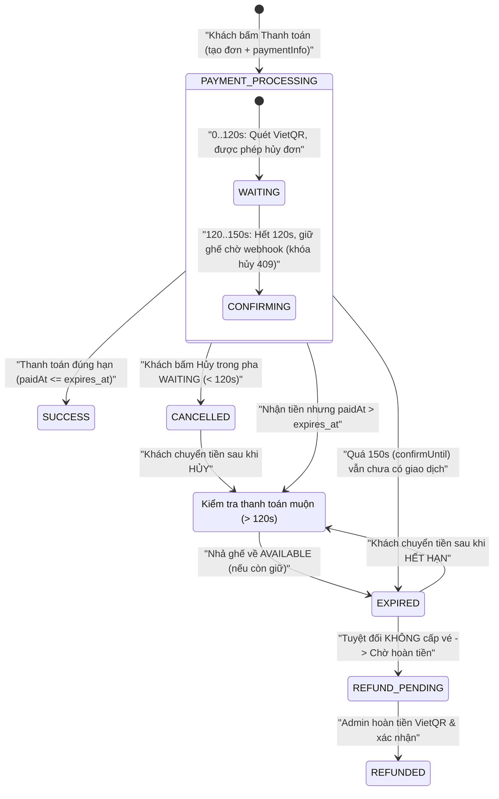

# Hướng dẫn Luồng Thanh toán PayOS QR Nội bộ & Giữ chỗ (Payment Flow Docs)

Tài liệu tóm tắt vòng đời đơn hàng, kiến trúc keeping-checkout-in-site (`120s + 30s`) và các luồng xử lý PayOS VietQR hiện tại trong hệ thống.

> [!TIP]
> Để xem đầy đủ chi tiết kỹ thuật Backend (Database `payment_info`, PayOS time parser `+07:00`, SSE Hub, chống 429, JSON DTO mẫu và Edge Case matrix), xem thêm [IN_SITE_PAYOS_QR_CHECKOUT.md](./IN_SITE_PAYOS_QR_CHECKOUT.md).

---

## 1. Vòng đời đơn hàng (`order_status`)

| Trạng thái | Pha / Ý nghĩa | Trạng thái ghế |
| :--- | :--- | :--- |
| `PAYMENT_PROCESSING` (`WAITING`) | Đang hiển thị mã QR trên `/checkout/:orderCode` (0..120s) | `PAYMENT_PROCESSING` (giữ tới `confirmUntil` = `T + 150s`) |
| `PAYMENT_PROCESSING` (`CONFIRMING`) | Đã hết 120s quét QR, chờ webhook ngân hàng thêm 30s (120..150s) | `PAYMENT_PROCESSING` (khóa hủy `409 Conflict`) |
| `SUCCESS` | Đã ghi nhận giao dịch hợp lệ (`paidAt <= expires_at`), phát E-Ticket | `SOLD` (Đã bán) |
| `CANCELLED` | Khách chủ động hủy đơn trong 120s | `AVAILABLE` (Mở lại ngay cho người khác) |
| `EXPIRED` | Quá 150s không nhận được tiền (hoặc giao dịch quá hạn) | `AVAILABLE` |
| `REFUND_PENDING` | Tiền vào sau `expires_at` (`> 120s`) hoặc sau khi đơn đã hủy/hết hạn | Ghế đã nhả, **không cấp vé**, chờ Admin hoàn tiền |
| `REFUNDED` | Admin đã chuyển khoản hoàn tiền thủ công qua VietQR và đóng băng snapshot | - |

---

## 2. Các luồng xử lý chi tiết

### A. Khách thanh toán bình thường (Happy Path — In-Site VietQR + SSE)
1. Khách hàng đã đăng nhập chọn ghế/khu vực → bấm **"Giữ chỗ ngay"** (`FOR UPDATE SKIP LOCKED`, giữ tạm `30s`).
2. Khách bấm **"Thanh toán"** → Frontend gọi `POST /api/seats/start-checkout`:
   - Backend tạo đơn `order_code` (9 chữ số) với `expires_at = now + 120s` và khóa ghế đến `confirmUntil = now + 150s`.
   - Backend gọi `payos.paymentRequests.create(...)`, lưu `checkout_url` + `payment_info` (`qrCode`, `bin`, `accountNumber`, `accountName`, `amount`, `description`) vào DB.
   - Frontend điều hướng nội bộ sang `/checkout/:orderCode`, vẽ mã QR bằng `QRCodeCanvas` và mở kết nối SSE `GET /api/orders/:orderCode/events`.
3. Khách quét mã QR trên App Ngân hàng (hoặc bấm App Deeplink trên mobile) và chuyển tiền trong `120s`:
   - PayOS gửi `POST /api/payos-webhook` về Backend (kèm HMAC signature và `transactionDateTime`).
   - Backend xác thực `paidAt <= expires_at`, cập nhật đơn thành `SUCCESS`, ghế thành `SOLD`, commit transaction và phát SSE `event: order_status` về Frontend.
   - Frontend hiển thị trạng thái thành công + pháo giấy + nút mở vé điện tử (`ETicketModal`) hoàn toàn tự động (không có nút xác nhận thủ công).

### B. Khách bấm Hủy đơn (WAITING vs CONFIRMING)
- **Trong 120s (`WAITING`):** Frontend gọi `POST /api/orders/:orderCode/cancel` (hoặc `/api/seats/release`). Backend cập nhật đơn thành `CANCELLED`, trả ghế về `AVAILABLE`, hủy link trên PayOS và phát SSE `CANCELLED`.
- **Từ giây 120 đến 150 (`CONFIRMING`):** Nút Hủy bị ẩn trên giao diện. Nếu có request hủy gọi thẳng vào API, Backend trả HTTP **`409 Conflict`** để bảo vệ đơn đang chờ webhook giờ chót (ví dụ khách bấm chuyển tiền ở giây 119).

### C. Khách chuyển tiền muộn (quá `expires_at` 120s → `REFUND_PENDING`)
Khác với thiết kế cũ, **hệ thống tuyệt đối không kích hoạt lại ghế hay cấp vé cho giao dịch thực hiện sau `expires_at`** (`paidAt.getTime() > expiresAt.getTime()`, quá dù chỉ `1ms`):
1. Nếu đơn vẫn đang `PAYMENT_PROCESSING`, Backend chuyển qua bước trung gian `EXPIRED` (nhả ghế về `AVAILABLE`) rồi chuyển thẳng sang `REFUND_PENDING` trong cùng transaction, sau đó phát SSE `REFUND_PENDING`.
2. Nếu đơn trước đó đã `CANCELLED` / `EXPIRED`, Backend cũng chuyển sang `REFUND_PENDING` (và đảm bảo ghế thuộc đơn đã được nhả).
3. **Admin xử lý hoàn tiền:**
   - Khách cập nhật thông tin tài khoản nhận hoàn tiền tại `/profile#bank`.
   - Admin vào `/admin` → tab **"Hoàn tiền"**, quét mã VietQR trên modal đối soát để chuyển trả tiền và bấm **"Xác nhận đã hoàn tiền"** (`REFUNDED`). Chi tiết xem [MANUAL_REFUND_VIETQR.md](../refund/MANUAL_REFUND_VIETQR.md).

---

## 3. Danh sách API chính

| Method | Endpoint | Mô tả |
| :--- | :--- | :--- |
| `GET` | `/api/seats/my-active-session` | Đồng bộ phiên `RESERVED` / `PAYMENT_PROCESSING` còn hạn (đến `confirmUntil`) xuyên thiết bị |
| `POST` | `/api/seats/reserve` | Giữ ghế tạm thời (`30s`) bằng cơ chế `FOR UPDATE SKIP LOCKED` |
| `POST` | `/api/seats/reserve-zone` | Giữ chỗ vé khu vực (`ZONE_BASED`) |
| `POST` | `/api/seats/start-checkout` | Tạo đơn (`120s`), khóa ghế (`150s`), lưu `payment_info` & trả QR payload |
| `GET` | `/api/orders/:orderCode/payment` | Lấy thông tin QR, pha (`WAITING`/`CONFIRMING`/`FINAL`) và chi tiết đơn; hỗ trợ `?sync=1` |
| `GET` | `/api/orders/:orderCode/events` | Kết nối SSE nhận trạng thái đơn realtime (`Authorization: Bearer`) |
| `GET` | `/api/orders/:orderCode/status` | Đồng bộ trạng thái đơn hàng giữa web và PayOS (có throttle 10s) |
| `POST` | `/api/orders/:orderCode/cancel` | Hủy đơn trong pha `WAITING` (trả `409` nếu đang `CONFIRMING` hoặc đã kết thúc) |
| `POST` | `/api/seats/release` | Giải phóng ghế đang giữ về `AVAILABLE` |
| `POST` | `/api/payos-webhook` | Webhook nhận kết quả tự động từ PayOS kèm xác thực HMAC SHA256 |
| `GET` | `/api/admin/refunds` | Lấy danh sách các đơn cần hoàn tiền / đã hoàn tiền |
| `POST` | `/api/admin/orders/:orderCode/confirm-refund` | Admin xác nhận đã hoàn tiền (`REFUNDED`) kèm snapshot |

---

## 🔗 Tài liệu liên quan
- [IN_SITE_PAYOS_QR_CHECKOUT.md](./IN_SITE_PAYOS_QR_CHECKOUT.md) — Đặc tả kỹ thuật chi tiết In-Site QR Checkout cho team Backend
- [MANUAL_REFUND_VIETQR.md](../refund/MANUAL_REFUND_VIETQR.md) — Hướng dẫn luồng hoàn tiền thủ công qua VietQR
